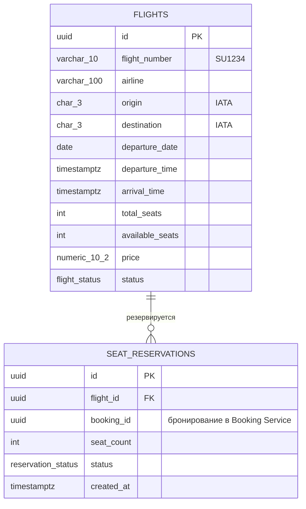
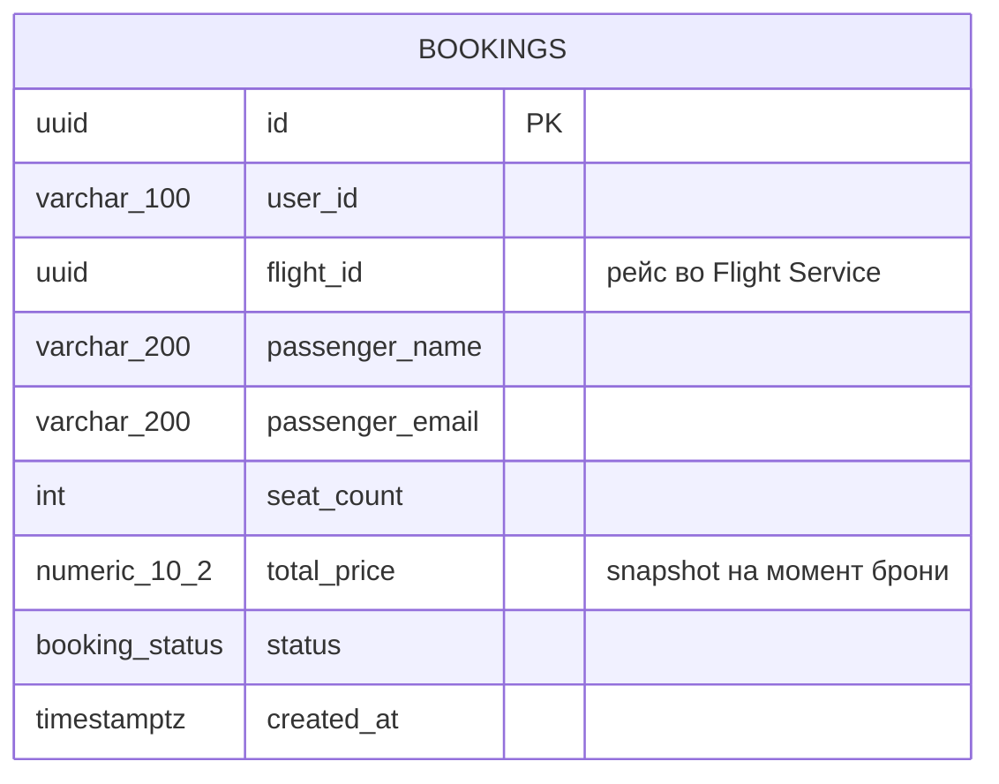

# ER-диаграмма (3NF)

Каждый сервис владеет своей базой: flight_db во Flight Service, booking_db в
Booking Service. Межсервисных FK нет - базы раздельные. Логические ссылки поддерживаются на уровне бизнес-флоу: 
перед бронированием Booking вызывает gRPC GetFlight, несуществующий рейс в бронирование попасть не может
Статусы - перечислимые PostgreSQL-типы, а не виртуальные строки
Деньги - NUMERIC(10,2), RUB

## Flight Service

### flights

| Поле | Тип | Описание |
|---|---|---|
| id | uuid | первичный ключ |
| flight_number | varchar(10) | номер рейса |
| airline | varchar(100) | авиакомпания |
| origin | char(3) | IATA-код аэропорта вылета |
| destination | char(3) | IATA-код аэропорта прилёта |
| departure_date | date | дата вылета, участвует в уникальности пары |
| departure_time | timestamptz | время вылета |
| arrival_time | timestamptz | время прилёта |
| total_seats | int | всего мест |
| available_seats | int | доступно мест, изменяется только в транзакциях |
| price | numeric(10,2) | цена одного места |
| status | flight_status | SCHEDULED, DEPARTED, CANCELLED, COMPLETED |

### seat_reservations

| Поле | Тип | Описание |
|---|---|---|
| id | uuid | первичный ключ |
| flight_id | uuid | FK на flights |
| booking_id | uuid | бронирование из Booking Service |
| seat_count | int | сколько мест захвачено |
| status | reservation_status | ACTIVE, RELEASED, EXPIRED |
| created_at | timestamptz | создание |

## Booking Service

### bookings

| Поле | Тип | Описание |
|---|---|---|
| id | uuid | первичный ключ; id генерируется до вызова ReserveSeats и используется как booking_id |
| user_id | varchar(100) | идентификатор пользователя |
| flight_id | uuid | рейс во Flight Service |
| passenger_name | varchar(200) | имя пассажира |
| passenger_email | varchar(200) | email пассажира |
| seat_count | int | количество мест |
| total_price | numeric(10,2) | зафиксированная стоимость бронирования |
| status | booking_status | CONFIRMED, CANCELLED |
| created_at | timestamptz | создание |

## Межсервисные ссылки

| Ссылка | Чем поддерживается |
|---|---|
| bookings.flight_id -> flights.id | логическая; проверка через gRPC GetFlight перед созданием брони |
| seat_reservations.booking_id -> bookings.id | логическая; UNIQUE гарантирует ровно одну резервацию на бронирование |

## Ограничения целостности

| Таблица | Ограничение |
|---|---|
| flights | total_seats > 0 |
| flights | available_seats >= 0 |
| flights | available_seats <= total_seats |
| flights | price > 0 |
| flights | UNIQUE (flight_number, departure_date) — SU1234 на конкретную дату существует ровно один раз |
| seat_reservations | seat_count > 0 |
| seat_reservations | UNIQUE (flight_id, booking_id) |
| bookings | seat_count > 0 |
| bookings | total_price >= 0 |

Осмотр: UNIQUE (flight_id, booking_id) — также механизм идемпотентности
ReserveSeats : повторная попытка с тем же booking_id не создаёт дубль, а возвращает существующую резервацию

## Индексы

| Таблица | Индекс | Зачем |
|---|---|---|
| flights | UNIQUE (flight_number, departure_date) | контроль дубликатов рейсов |
| seat_reservations | UNIQUE (flight_id, booking_id) | идемпотентность ReserveSeats |
| bookings | (user_id) | GET /bookings?user_id= |

## Обоснование 3NF

- 1NF: все значения атомарны — таблицы не хранят массивы и вложенные структуры
- 2NF: ключи суррогатные (uuid), неключевые атрибуты зависят от ключа целиком
- 3NF: без транзитивных зависимостей — маршрут и вместимость живут только в
  flights; bookings не дублирует данные рейса, хранит лишь flight_id и
  зафиксированную сумму (снапшот бизнес-решения, а не вычисляемое поле);
  available_seats — счётчик состояния, консистентность обеспечивают
  транзакции, а не пересчёт при чтении